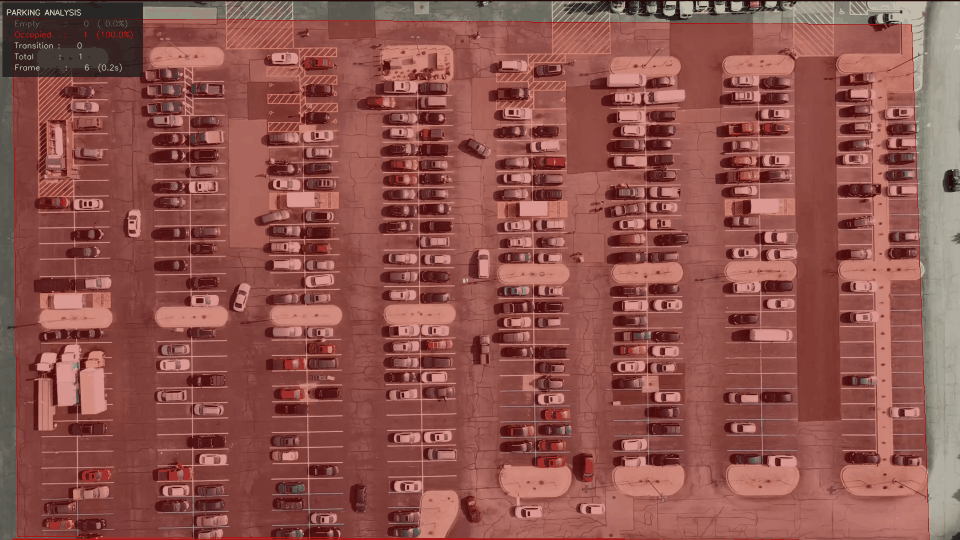

# 🅿️ Smart Parking Detection System

> **Real-time computer vision pipeline for parking slot occupancy detection from aerial video footage.**  
> Detects empty and occupied parking spaces using texture-variance analysis — no ML model or GPU required.

---

## 📽️ Demo



Each parking slot is annotated in real time:

| Color | Meaning |
|-------|---------|
| 🟩 Green | Empty slot |
| 🟥 Red | Occupied slot |
| 🟨 Yellow | Transition (car arriving or leaving) |

A live stats panel (top-left) shows counts and percentages per frame.

---

## 📁 Project Structure

```
smart-parking-detection/
│
├── parking_detector.py     # Main detection pipeline (v6)
├── diagnose.py             # Diagnostic tool — analyzes pixel stats from your video
├── annotator.py            # Interactive slot annotator with zoom/pan/undo
├── slots_fixed.json        # Corrected parking slot coordinates (mapped from real frame)
├── slots.json              # Original auto-generated slot coordinates (do not use)
├── output/
│   ├── parking_detection.mp4   # Full resolution annotated video
│   └── parking_detection.gif   # Shareable animated preview
└── README.md               # This file
```

---

## ⚡ Quick Start

### 1. Install dependencies

```powershell
pip uninstall opencv-python opencv-python-headless opencv-contrib-python -y
pip install opencv-python-headless numpy pillow imageio scipy
```

### 2. Run detection

```powershell
C:\Python313\python.exe parking_detector.py --video parking_1920_1080.mp4 --slots slots_fixed.json --frames 120
```

### 3. Run with debug output (prints per-slot scores on frame 1)

```powershell
C:\Python313\python.exe parking_detector.py --video parking_1920_1080.mp4 --slots slots_fixed.json --frames 120 --debug
```

### 4. Extract a clean frame from your video (for slot mapping)

```powershell
C:\Python313\python.exe -c "import cv2; cap=cv2.VideoCapture('parking_1920_1080.mp4'); ret,f=cap.read(); cv2.imwrite('frame0.png',f); cap.release()"
```

---

## 🎛️ Full CLI Options — parking_detector.py

| Flag | Default | Description |
|------|---------|-------------|
| `--video` | `parking_1920_1080.mp4` | Path to your MP4/AVI parking video |
| `--slots` | `slots.json` | Path to slot coordinates JSON file |
| `--frames` | `120` | Number of frames to process |
| `--out-gif` | `parking_detection.gif` | Output GIF filename |
| `--out-mp4` | `parking_detection.mp4` | Output MP4 filename |
| `--annotate` | off | Launch the interactive slot annotator |
| `--debug` | off | Print per-slot pixel scores on frame 1 for threshold tuning |

---

## 🔧 Tools

### diagnose.py — Pixel analysis

Run this when detection isn't working to understand what your video's pixel values look like. It samples lane bands and slot ROIs and prints HSV statistics that tell you whether brightness, saturation, or texture variance is the useful signal for your footage.

```powershell
C:\Python313\python.exe diagnose.py --video parking_1920_1080.mp4 --slots slots_fixed.json
```

Output includes:
- Per-slot mean H, S, V, std_V, edge density
- Detected lane band positions
- A summary comparing slot vs lane pixel stats
- A `debug_frame.png` saved to `output/` showing yellow slot outlines and cyan lane bands

### annotator.py — Manual slot annotation

Use this to draw your own slot polygons from scratch or correct existing ones.

```powershell
C:\Python313\python.exe annotator.py --video parking_1920_1080.mp4
```

To resume from an existing file:

```powershell
C:\Python313\python.exe annotator.py --video parking_1920_1080.mp4 --resume slots_fixed.json
```

**Controls:**

| Key / Action | Effect |
|---|---|
| Left-click | Place a corner point (need 4 per slot) |
| SPACE | Confirm slot after 4 points |
| CTRL+Z | Undo last slot or last point |
| S | Save progress without quitting |
| Q / ESC | Save and quit |
| Scroll wheel | Zoom in/out toward mouse |
| Middle-drag | Pan around the frame |

Auto-saves every 10 confirmed slots. Output goes to `slots_new.json` by default.

---

## 📍 Slot JSON Format

```json
[
  {
    "id": 1,
    "polygon": [[88, 103], [163, 103], [163, 130], [88, 130]]
  },
  {
    "id": 2,
    "polygon": [[88, 130], [163, 130], [163, 163], [88, 163]]
  }
]
```

Each polygon is **4 points** `[x, y]` going clockwise from top-left. The slot ID must be unique.

---

## 🧠 How It Works

```
Video Frame
     │
     ▼
┌──────────────────────────────┐
│  ROI Extraction               │  ← Each slot polygon perspective-warped
│  (perspective warp to 80×40) │     to a fixed 80×40px rectangle
└─────────────┬────────────────┘
              │
              ▼
┌──────────────────────────────┐
│  Texture-Variance Classifier  │  ← 5 features computed per ROI:
│                               │     1. std_V  — brightness variance
│                               │     2. Spatial contrast (quad analysis)
│                               │     3. Dark patch fraction
│                               │     4. Sobel gradient energy
│                               │     5. Bright spot ratio
└─────────────┬────────────────┘
              │  score 0.0–1.0
              ▼
         score ≥ 0.50  →  OCCUPIED
    0.28 ≤ score < 0.50  →  TRANSITION
         score < 0.28  →  EMPTY
              │
              ▼
┌──────────────────────────────┐
│  Temporal Smoothing           │  ← Suppresses rapid flips when
│                               │     new confidence < 0.30
└─────────────┬────────────────┘
              │
     ┌────────┴────────┐
     ▼                 ▼
  MP4 output       GIF output
  (full res)      (preview)
```

### Why texture variance?

Diagnostic analysis of this footage showed that brightness (V channel mean) and saturation are nearly identical between empty asphalt and cars from above — both around 121–122. The only reliable signal is **local texture variance**: empty asphalt is smooth and uniform (std_V ~20–28), while cars have panels, windows, and shadows that create uneven brightness patterns (std_V ~40–55).

---

## 📊 Console Output Example

```
Loaded 368 slots from slots_fixed.json
Video: 1920x1080 @ 30.0 fps  (849 frames total)
Processing up to 120 frames (every 2nd)...

  Frame   20 | Occ: 87  Emp:241  Trans: 40
  Frame   40 | Occ: 89  Emp:239  Trans: 40
  Frame   60 | Occ: 91  Emp:238  Trans: 39
  ...

MP4 → output\parking_detection.mp4
GIF → output\parking_detection.gif
Done. Processed 120 frames, 368 slots.
```

---

## 🐛 Troubleshooting

### `AttributeError: module 'cv2' has no attribute 'VideoCapture'`
Multiple conflicting OpenCV packages are installed. Fix:
```powershell
pip uninstall opencv-python opencv-python-headless opencv-contrib-python -y; pip install opencv-python-headless
```

### Everything shows as OCCUPIED (0 empty slots)
1. Run `diagnose.py` first and check the summary line `Avg slot vs lane V diff`.
2. If it says `small — V-diff alone won't work`, the lane-reference approach can't help — the texture classifier is the right one.
3. Run with `--debug` and paste the per-slot scores here to tune `OCCUPIED_THRESH` and `EMPTY_THRESH` in `parking_detector.py`.

### Slots are covering driving lanes or wrong areas
Your `slots.json` coordinates don't match your video. Either:
- Use `slots_fixed.json` (mapped from the actual frame)
- Or re-run the slot mapping script with your own `frame0.png`

### `ERROR: slots file not found`
Make sure `slots_fixed.json` is in the same folder as `parking_detector.py`, not inside `output/`.

---

## 📦 Requirements

```
opencv-python-headless >= 4.8
numpy >= 1.24
pillow >= 10.0
imageio >= 2.31
scipy >= 1.10
```

Install:
```powershell
pip install opencv-python-headless numpy pillow imageio scipy
```

---

## 🚀 Extending the Project

### Swap in a YOLOv8 model for higher accuracy

```python
from ultralytics import YOLO
model = YOLO("yolov8n.pt")

def classify(self, roi, debug=False):
    results = model(roi, verbose=False)
    for box in results[0].boxes:
        if int(box.cls) == 2:  # class 2 = car in COCO
            return "OCCUPIED", float(box.conf), 1.0
    return "EMPTY", 0.95, 0.0
```

### Use a live camera or RTSP stream

```powershell
C:\Python313\python.exe parking_detector.py --video 0
C:\Python313\python.exe parking_detector.py --video rtsp://192.168.1.100/stream
```

### Process a longer video

```powershell
C:\Python313\python.exe parking_detector.py --video parking_1920_1080.mp4 --slots slots_fixed.json --frames 500
```

---

## 📄 License

MIT — free to use, modify, and distribute.

---

## 👤 Author

Built with OpenCV, NumPy, and Python.  
Classifier tuned from real diagnostic pixel analysis of 1920×1080 aerial parking footage.
